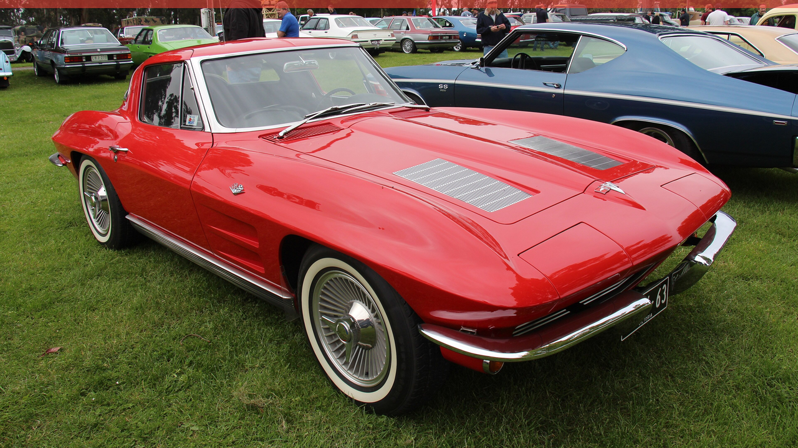

# Riverside Red

A dark Omarchy theme built from 1963 Chevrolet Corvette Sting Ray coupe in Riverside Red.



## What it is

Riverside Red on a split-window Sting Ray is the loudest red Chevrolet sold in 1963. Oxide-dark surfaces underneath, a hot red on top, and no pastel anywhere in the palette.

## Install

```bash
omarchy theme install https://github.com/offback/omarchy-riverside-red-theme.git
# or, from a local clone:
cp -r omarchy-riverside-red-theme ~/.config/omarchy/themes/
omarchy theme set riverside-red
```

## Palette

| Key | Value | |
|---|---|---|
| accent | `#ef4438` | the paint colour |
| background | `#210f0f` | |
| foreground | `#eed2d0` | |
| muted | `#7d5452` | |
| selection | `#33110f` | |

Every colour lives in `colors.toml`; Omarchy generates the rest
(Alacritty, btop, Waybar, Hyprland, Neovim, VS Code, Chromium, walker, mako …).

## Wallpapers

| File | Photograph | Licence |
|---|---|---|
| `backgrounds/001-sting-ray-riverside-red.jpg` | [1963 Chevrolet C2 Corvette Coupe (15269076897).jpg](https://commons.wikimedia.org/wiki/File:1963_Chevrolet_C2_Corvette_Coupe_(15269076897).jpg) | CC BY 2.0 |
| `backgrounds/002-sting-ray-convertible-red.jpg` | [1963 Chevrolet C2 Corvette Convertible (16337138697).jpg](https://commons.wikimedia.org/wiki/File:1963_Chevrolet_C2_Corvette_Convertible_(16337138697).jpg) | CC BY 2.0 |

Photographs are **not** covered by this theme's MIT licence. See
[ATTRIBUTION.md](ATTRIBUTION.md) for the author, licence and source of each one.

## Licence

MIT for the theme files (`colors.toml`, `preview.png`, `icons.theme`,
`keyboard.rgb`, this README). The wallpaper photographs keep their own licences.
